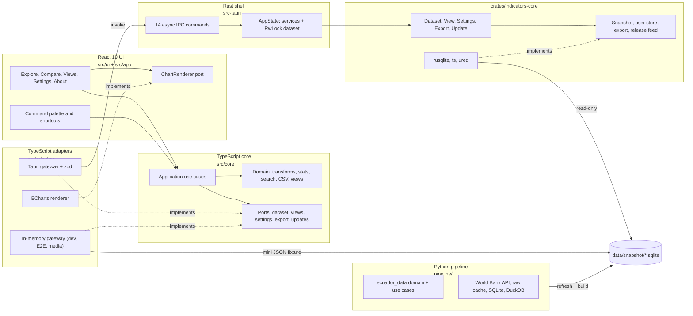
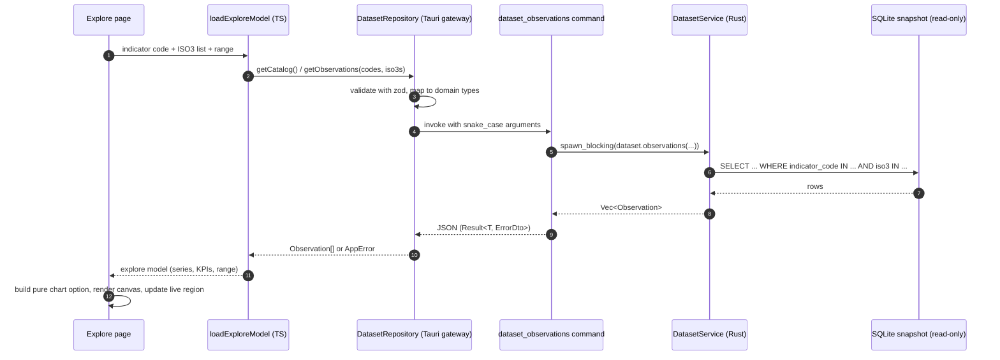
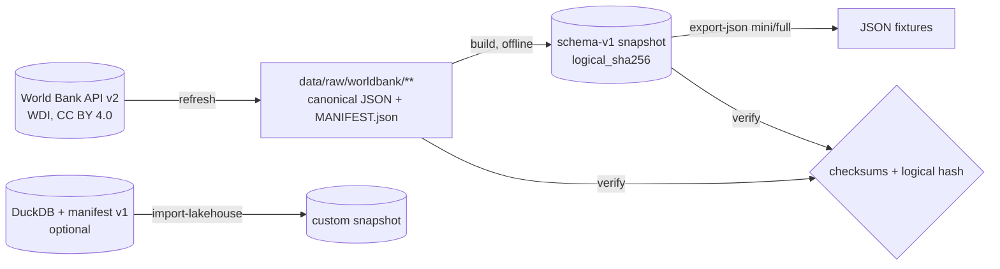

# Architecture

Ecuador Indicators is one product built from three runtimes that share a single
contract: a typed SQLite snapshot, a tagged view model and a small set of
stable error codes. The desktop app reads the snapshot; the Python pipeline
creates it. Nothing in the desktop runtime imports the pipeline.

## System at a glance

The UI never talks to SQLite. The Rust core never imports Tauri. The Python
domain never imports `httpx`, `duckdb` or `sqlite3`. Those rules are executable
(see [Dependency rules](#dependency-rules-and-how-they-are-enforced)).

## Repository map

| Path | Responsibility |
|---|---|
| `src/core` | Pure TypeScript: branded domain types, series/statistics/CSV/search, URL view state, use cases and ports. No React, DOM, Tauri or ECharts imports. |
| `src/adapters/tauri` | IPC gateway with zod validation, wire-to-domain mappers and committed `.ts` bindings generated by `ts-rs`. |
| `src/adapters/memory` | JSON snapshot gateway over `localStorage`, the decorators (`CachedDatasetRepository`, `FaultInjectingDatasetRepository`) and test/media fixtures. |
| `src/ui` | Design tokens, accessible primitives, i18n, charts and feature pages. Only imports the core types/use cases and presentation libraries. |
| `src/app` | Composition root: adapter selection, providers, hash router, shell and shortcut registry. |
| `crates/indicators-core` | Rust domain, ports, application services and infrastructure adapters (SQLite, filesystem, HTTP). |
| `src-tauri` | Tauri shell: CLI, typed config, logging, state, 14 commands, self-check, plugins and window lifecycle. |
| `pipeline` | Python 3.12 `ecuador-data` package: refresh, build, verify, lakehouse import, JSON export. |
| `scripts` | Cross-platform Node ESM release, quality and metric scripts, each covered by Vitest where behaviour is non-trivial. |
| `e2e`, `e2e-native` | Playwright browser suite (Chromium + WebKit) and WebdriverIO native suite (Linux). |

## Dependency rules and how they are enforced

| Layer | May import | Must not import | Enforced by |
|---|---|---|---|
| TS `core/domain` | itself | `application`, `contracts`, `adapters`, `ui`, `app`, React, Tauri, ECharts | `src/architecture.test.ts` |
| TS `core/application` | `core/domain`, own `ports` | `adapters`, `ui`, `app`, React, Tauri | `src/architecture.test.ts` |
| TS `core/contracts` | `core/domain`, `zod`, generated wire types | `ui`, `app` | `src/architecture.test.ts` |
| TS `adapters/*` | `core/*`, Tauri API, `zod` | `ui`, `app` | `src/architecture.test.ts` |
| TS `ui/*` | `core/domain`, `core/application` types, `ui/*`, React, Radix, lucide, ECharts | `adapters/*`, `app/*`, generated bindings, `@tauri-apps/*` | `src/architecture.test.ts` |
| TS `app/*` | everything (composition root) | n/a | n/a |
| Rust `domain`, `ports`, `application` | `std`, `serde`, `ts-rs`, `thiserror`, `semver`, own modules | `rusqlite`, `ureq`, `tauri`, `std::fs`, `std::net`, `std::env` | `crates/indicators-core/tests/architecture.rs` |
| Rust `adapters` | `ports`, `domain`, `rusqlite`, `ureq`, `sha2`, `std::fs` | `application` | `architecture.rs` plus the dependency graph assertion |
| `src-tauri` | `indicators-core`, Tauri crates | reverse imports from the core | workspace Cargo graph |
| Python `domain` | stdlib, `pydantic` | `ports`, `application`, `adapters`, `httpx`, `duckdb`, `sqlite3` | import-linter |
| Python `application` | `domain`, `ports` | `adapters` | import-linter |
| Python `adapters` | `domain`, `ports`, `httpx`, `duckdb`, `sqlite3` | `application` | import-linter |

Each architecture test was shown to fail on a deliberate violation (RED evidence
in the task log): a `rusqlite` import in the Rust domain, `@tauri-apps/api` in
the TypeScript core and `httpx` in the Python domain all break their contract.

## Ports and adapters

| Runtime | Port | Production adapter | Test / alternative adapter |
|---|---|---|---|
| TypeScript | `DatasetRepository` (`getInfo`, `getCatalog`, `getObservations`, `openSnapshot`, `resetSnapshot`) | `TauriGateway` | `MemoryGateway`; `CachedDatasetRepository`; `FaultInjectingDatasetRepository` |
| TypeScript | `ViewRepository`, `SettingsRepository` | `TauriGateway` | `MemoryGateway` over `localStorage` |
| TypeScript | `ExportGateway`, `SnapshotPicker`, `UpdateGateway`, `AppInfoGateway`, `ExternalLinkGateway` | Tauri plugins (`dialog`, `opener`, `invoke`) | memory download / no-op picker |
| TypeScript (UI) | `ChartRenderer` (`setOption`, `showTip`, `hideTip`, `toDataURL`, `resize`, `dispose`) | `EchartsRenderer` | `FakeChartRenderer` |
| Rust | `SnapshotReader`, `SnapshotOpener` | `SqliteSnapshotReader`, `SqliteSnapshotOpener` | temporary SQLite fixtures |
| Rust | `UserStore` | `SqliteUserStore` | real temp SQLite in tests |
| Rust | `ExportWriter` | `FsExportWriter` | temp directories |
| Rust | `ReleaseFeed`, `HttpGet` | `GithubReleaseFeed` over `UreqHttpGet` | `httpmock` server + recorded JSON |
| Rust | `Clock`, `IdGenerator` | `SystemClock`, `UuidGenerator` | deterministic fakes |
| Python | `IndicatorSource` | `WorldBankApiSource` | recorded `respx` fixtures |
| Python | `RawStore` | `FileRawStore` | temp directories |
| Python | `SnapshotWriter` | `SqliteSnapshotWriter` | real temp SQLite |
| Python | `Clock` | `SystemClock` | fixed clock |

The port definitions are in `src/core/application/ports.ts`,
`crates/indicators-core/src/ports.rs` and `pipeline/src/ecuador_data/ports.py`.

## Patterns used deliberately

| Pattern | Where | Why |
|---|---|---|
| Ports and adapters | all three runtimes | Keeps product logic independent of Tauri, SQLite, HTTP and the DOM. |
| Repository | `DatasetRepository`, `ViewRepository`, `SettingsRepository`; Rust `UserStore` | One typed API for persistence instead of scattered commands. |
| Strategy | `RankingStrategy` in search; transform functions selected by `Transform` | Search ranking and year-over-year/index transforms are swappable and testable in isolation. |
| Command | `src/app/shortcuts/registry.ts` and palette actions | One registry defines ids, shortcuts, availability and execution; the UI only dispatches commands. |
| Builder | `buildChartOption`, `buildTrajectoriesOption`, `buildRankingOption` | Pure option objects are asserted without a canvas. |
| Decorator | `CachedDatasetRepository`, `FaultInjectingDatasetRepository` | Caching and test fault injection compose over the real port. |
| Composition root | `src/app/bootstrap.ts`, `src-tauri/src/lib.rs`, `ecuador_data/cli.py` | Only composition roots know concrete adapters. |
| Result / typed error | `Result<T, AppError>` (TS), `Result<T, CoreError>` (Rust), typed exceptions at the Python CLI boundary | Failures stay values until a boundary translates them for users. |
| Clock / id injection | Rust `Clock`, `IdGenerator`; Python `Clock` | Saved-view timestamps and ids are deterministic in tests. |
| Anti-corruption mapping | `src/adapters/tauri/mappers.ts` | Wire DTOs (snake_case) become branded domain types (`IndicatorCode`, `Iso3`, `Year`). |

## Opening an indicator, end to end

The URL hash is the source of truth for what the user sees. Query keys are
parsed into a typed Explore/Compare state, sanitized against the catalog and
serialized back without defaults. Saved views store the same state, so reopening
a view is the same code path as a deep link.

## Error model

IPC failures are always `ErrorDto {code, message}` with a stable code. The UI
maps each code to a translated message and, where recovery is possible, an
action. The Rust core is authoritative for saved-view validation; TypeScript
mirrors it for fast feedback.

| Code | Meaning | Typical recovery |
|---|---|---|
| `SNAPSHOT_INVALID` | The selected SQLite file is not a valid schema-v1 snapshot. | Keep the previous dataset; offer Reset to bundled. |
| `SNAPSHOT_NOT_FOUND` | The configured snapshot path does not exist. | Dataset problem screen with reset. |
| `VIEW_NOT_FOUND` | The saved view id no longer exists. | Refresh the list. |
| `VIEW_INVALID` | The view name or spec violates the model. | Inline validation in the save dialog. |
| `LIMIT_EXCEEDED` | The 200-view limit was reached. | Delete an old view. |
| `STORAGE` | SQLite/filesystem failure in the user store. | Retry; the error state shows details. |
| `EXPORT_REJECTED` | The export path is not `.csv`/`.png`, has no filename or exceeds 50 MiB. | Choose another path/format. |
| `UPDATE_FEED` | The GitHub release feed could not be interpreted. | Show the error, keep the app usable. |
| `NETWORK` | The update check failed at the transport layer. | Retry when online. |
| `INTERNAL` | Unexpected failure (lock poisoning, join error, bug). | Retry, then report. |
| `INVALID_INPUT` | Client-side validation failure before IPC. | Fix the input. |

The pipeline uses typed exceptions and exit codes instead: `0` success, `1`
unexpected error, `2` integrity/validation failure (`IntegrityError`,
`ManifestError`, `CatalogError`) and `3` source unavailable
(`SourceUnavailableError`, `SourceProtocolError`).

## Concurrency and state

- `AppState` holds one `RwLock<Arc<DatasetService>>`; the dataset service swaps
  its active `SnapshotReader` under its own lock. A failed open leaves both the
  reader and the `Arc` untouched, so an invalid custom snapshot never replaces a
  working dataset.
- Every Tauri command is `async` and delegates blocking SQLite and filesystem
  work to `tauri::async_runtime::spawn_blocking`; the webview thread never waits
  on I/O.
- SQLite connections are guarded by a `Mutex`. The snapshot is opened
  `SQLITE_OPEN_READ_ONLY` with `PRAGMA query_only = ON`; the user store enables
  WAL and runs `rusqlite_migration` once.
- Exports are written to a temporary file in the target directory and renamed
  into place; on Windows the destination is replaced explicitly.
- The update check is opt-in, throttled to one check per 24 hours at launch and
  never downloads or installs anything. `ReleaseFeed` is the only network port.

## Data pipeline

`data/MANIFEST.json` records every raw file (URL, retrieval time, byte size,
SHA-256), the source `lastupdated`, the snapshot file hash and the logical
content hash. `verify` recomputes both hashes and fails with exit 2 naming the
file and the expected/actual values. See [DATA.md](DATA.md) for the schema,
licences and limitations, and
[LAKEHOUSE-MANIFEST.md](LAKEHOUSE-MANIFEST.md) for the optional DuckDB import.

## How to add an indicator

1. Add the code, topic, `value_kind`, decimals, `higher_is` and both unit labels
   to `pipeline/catalog/indicators.toml` (topics live in the same file).
2. Run `cd pipeline && uv run ecuador-data refresh` (network) and commit the new
   raw files plus `data/MANIFEST.json`; then `uv run ecuador-data build` and
   `uv run ecuador-data verify`.
3. Regenerate the JSON fixtures:
   `uv run ecuador-data export-json --subset mini --out ../src/adapters/memory/fixtures/mini.snapshot.json`;
   the full snapshot fixture used by media capture is built with
   `node scripts/prepare-web-fixture.mjs full`.
4. No TypeScript or Rust code changes are needed: the catalog, observations,
   translations and units all come from the snapshot. Add a test only if the
   indicator exposes a new `value_kind` or formatting rule.
5. Run `npm run verify` and commit the catalog, data and fixture changes
   together.

## How to add a data source adapter

1. Implement the Python `IndicatorSource` and/or `RawStore` port in
   `pipeline/src/ecuador_data/adapters/`. The adapter may import the SDK/HTTP
   client; the domain and application layers may not.
2. Translate upstream failures into `SourceUnavailableError` or
   `SourceProtocolError` so the CLI keeps its documented exit codes.
3. Add `respx` fixtures (or recorded files) and tests for pagination, retries,
   null values, bilingual metadata and error envelopes. No test may touch the
   network.
4. Document the source, licence evidence, checksums and attribution in
   [DATA.md](DATA.md) and add a row to `data/MANIFEST.json` when it becomes part
   of the bundled build.
5. If the source is optional, keep it behind a CLI flag or a separate command
   and never import it from the desktop runtime (see ADR 0009 for the lakehouse
   precedent).

## Testing the architecture

| Command | Contract |
|---|---|
| `npx vitest run src/architecture.test.ts` | TypeScript import graph and browser-global rules |
| `cargo test -p indicators-core --test architecture` | Rust forbidden tokens and Cargo dependency graph |
| `uv run --directory pipeline lint-imports` | Python hexagonal layers and infrastructure imports |
| `npm run check:bindings` | `ts-rs` output matches the committed TypeScript bindings |

The tests are intentionally dumb (regexes and dependency lists) because a
simple contract that fails loudly is more valuable here than a clever static
analysis that can be skipped.

## Further reading

- [ADR 0003](adr/0003-hexagonal-architecture-across-runtimes.md): hexagonal
  architecture and the wire-DTO trade-off.
- [ADR 0004](adr/0004-ipc-contract-and-typed-bindings.md): the 14 IPC commands
  and generated bindings.
- [ADR 0005](adr/0005-ui-system-tokens-and-primitives.md): tokens and
  accessibility primitives.
- [ADR 0006](adr/0006-charting-and-chart-accessibility.md): ECharts and the
  chart accessibility alternative.
- [ADR 0007](adr/0007-testing-strategy.md): browser E2E strategy.
- [Data guide](DATA.md) · [Design system](DESIGN.md) · [Testing](TESTING.md) ·
  [Installation](INSTALL.md) · [Releasing](RELEASING.md).
