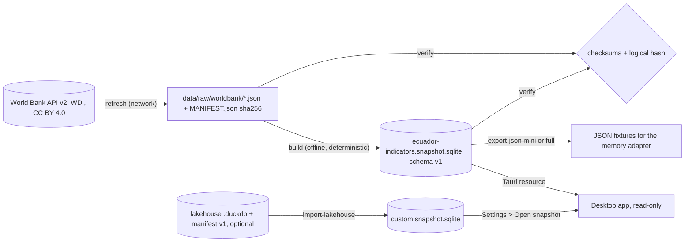

# Data guide

Ecuador Indicators is an offline-first application that republishes a bundled
subset of the World Bank's World Development Indicators (WDI). It is not an
official statistics product and does not claim to be one.

## Source and licence

| Item | Value |
|---|---|
| Source | World Bank, World Development Indicators (WDI), source id 2 |
| API | `https://api.worldbank.org/v2` (no key) |
| Dataset page | <https://datacatalog.worldbank.org/search/dataset/0037712/world-development-indicators> |
| Licence | CC BY 4.0, <https://creativecommons.org/licenses/by/4.0/> |
| Terms | <https://datacatalog.worldbank.org/public-licenses> |
| Retrieval | `path` / `url` / `sha256` per file in `data/MANIFEST.json` |
| Coverage | Annual observations from 1960 to 2026 (the API range), seven geographies |
| Indicators | 38, curated in `pipeline/catalog/indicators.toml`, across 8 topics |
| Geographies | ECU, COL, PER, CHL, BOL, Latin America & Caribbean (LCN), World (WLD) |

The full attribution text is stored in the snapshot (`meta.attribution_en` and
`meta.attribution_es`) and shown in the application. Underlying providers such
as ILO, UNESCO, WHO, FAO, UNODC, ITU, IMF, UN and the World Bank itself are
credited per indicator through `source_org_en` / `source_org_es`. See
[`THIRD_PARTY_NOTICES.md`](../THIRD_PARTY_NOTICES.md).

The bundled snapshot is generated data. Never edit `data/raw/**` or the SQLite
file by hand: refresh or rebuild it with the commands below.

## Bundled snapshot

`data/snapshot/ecuador-indicators.snapshot.sqlite` is a SQLite database with
schema version 1 (`PRAGMA user_version = 1`). The exact DDL lives in
`pipeline/src/ecuador_data/adapters/sqlite_snapshot.py`:

| Table | Contents |
|---|---|
| `meta` | Provenance: schema, dataset, origin, source, retrieval date, licence, attribution, pipeline version, logical hash |
| `topic` | 8 curated topics with English and Spanish names and sort order |
| `geography` | 7 geographies with ISO codes, bilingual names, aggregate flag |
| `indicator` | 38 indicators with bilingual names, descriptions and source organizations, unit labels, value kind, decimals, `higher_is`, topic and order |
| `observation` | One row per indicator, geography and year with a finite `REAL` value |

Required `meta` keys: `schema_version`, `dataset_id`, `dataset_version`,
`origin` (`worldbank` or `lakehouse`), `source_name`, `source_publisher`,
`source_last_updated`, `retrieved_at`, `license`, `license_url`,
`attribution_en`, `attribution_es`, `pipeline_version`, `logical_sha256`.

### Integrity model

- Each raw file is canonical JSON (`sort_keys`, compact separators, UTF-8,
  trailing newline) recorded in `data/MANIFEST.json` with its URL, byte size and
  SHA-256.
- `meta.logical_sha256` hashes a canonical text dump of all tables except the
  hash itself, in table order `topic, geography, indicator, observation, meta`,
  rows ordered by primary key. Two builds from the same raw cache produce the
  same logical hash regardless of input row order or SQLite page layout.
- `data/MANIFEST.json` also records the SHA-256 of the snapshot file bytes, so
  the shipped file can be matched against the committed manifest.
- `verify` checks raw checksums, the snapshot file hash, the schema, the counts
  and the recomputed logical hash; it exits `2` on any mismatch.

## Lineage



## Reproduce the dataset

Prerequisites: Python 3.12 and uv (the pipeline pins them in
`pipeline/pyproject.toml` and `.python-version`). Run from `pipeline/` unless a
command says otherwise. The default data directory is the repository `data/`;
override it with `ECUADOR_DATA_DATA_DIR`.

```bash
cd pipeline
uv sync --frozen

# 1. Fetch metadata in English and Spanish plus observations (network).
uv run ecuador-data refresh

# 2. Build the deterministic snapshot and update data/MANIFEST.json.
uv run ecuador-data build

# 3. Check raw checksums, snapshot schema, counts and both hashes.
uv run ecuador-data verify
```

`build` is offline. Two runs from the same raw cache print the same
`logical_sha256`; CI compares it with the manifest and rebuilds the mini
fixtures.

### Mini subset

`pipeline/catalog/mini.toml` selects six indicators and five geographies. It
feeds the Rust contract fixture and the in-memory adapter fixture:

```bash
cd pipeline
uv run ecuador-data build --subset mini --out ../crates/indicators-core/tests/fixtures/mini.snapshot.sqlite
uv run ecuador-data export-json --subset mini --out ../src/adapters/memory/fixtures/mini.snapshot.json
```

`export-json` runs the same deterministic build in a temporary directory and
writes canonical JSON:
`{"schema_version":1,"meta":{...},"topics":[...],"geographies":[...],"indicators":[...],"observations":[[code,iso3,year,value],...]}`
with tables sorted by primary key. The command is byte-reproducible.

### Lakehouse import (optional)

```bash
cd pipeline
uv sync --extra lakehouse
uv run ecuador-data import-lakehouse --manifest ../sibling/manifest.json --out ../data/from-lakehouse.sqlite
```

The DuckDB file is opened read-only and is never linked into the desktop
runtime. The contract, example and error table are in
[`LAKEHOUSE-MANIFEST.md`](LAKEHOUSE-MANIFEST.md).

## Inspecting a snapshot

```bash
sqlite3 data/snapshot/ecuador-indicators.snapshot.sqlite \
  "PRAGMA user_version; SELECT value FROM meta WHERE key='license';"
sqlite3 data/snapshot/ecuador-indicators.snapshot.sqlite \
  "SELECT COUNT(*) FROM observation; SELECT COUNT(*) FROM indicator;"
jq '.snapshot.counts' data/MANIFEST.json
```

## Checksums policy

- `data/MANIFEST.json` is the authority for the raw cache and the bundled
  snapshot. A refresh regenerates it; review the diff before committing.
- Raw files are never edited; a changed file is either re-fetched or the
  manifest is wrong. `verify` names the file and the expected/actual values.
- The desktop self-check compares the bundled snapshot bytes with the bundled
  manifest. The logical hash is not recomputed in Rust.
- Release installers are published with `SHA256SUMS.txt` and a build-provenance
  attestation; see `docs/INSTALL.md` (release task).

## Limitations

- **Annual data only.** WDI series are annual; the application does not bundle
  monthly or quarterly series.
- **Reporting lags.** Different series end in different years (for example
  maternal mortality through 2023, literacy through 2024, GDP through 2025).
  Missing values are gaps, never zero.
- **Estimates and models.** Several indicators are modelled estimates (ILO
  labour series, WHO/UN mortality and health series, UN population projections,
  World Bank poverty estimates). They are not raw survey counts.
- **No official statistics claim.** The app republishes WDI and says so; it is
  not an official BCE or INEC product.
- **BCE and INEC are not bundled.** BCE states no licence for statistical data,
  and INEC's CC BY 4.0 footer does not clearly cover the linked datasets; both
  lack a verified stable machine-readable endpoint. They are candidates for a
  future `IndicatorSource` adapter only after written clearance.
- **Aggregates.** LCN and WLD are World Bank aggregates, not countries. Their
  poverty and Gini series are absent where the World Bank does not publish
  aggregate values.
- **Spanish metadata** comes from the World Bank's Spanish API; derived values
  are computed by the application and are not official World Bank calculations.
